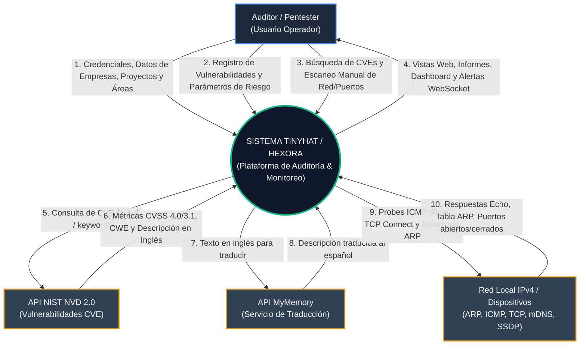
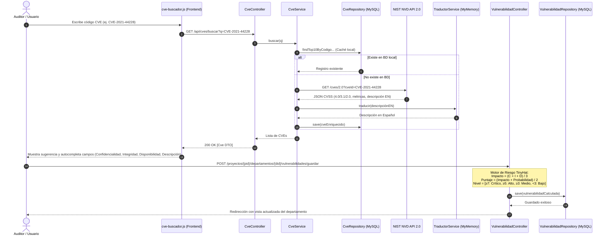
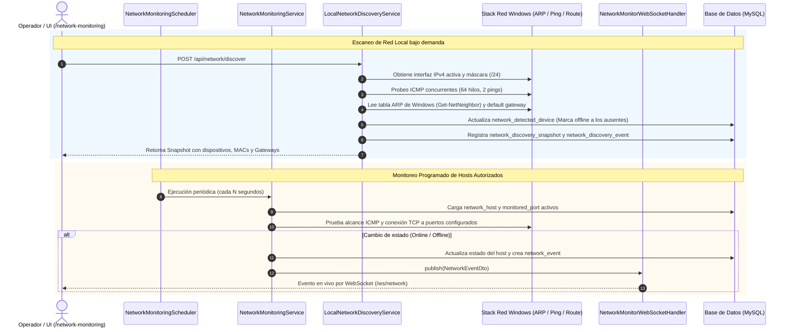

# Diagrama de Flujo de Datos (DFD) del Sistema TinyHat / Hexora

Este documento describe de manera exhaustiva el flujo de información de todo el sistema **TinyHat** (Hexora), incluyendo sus entidades externas, procesos internos, almacenes de datos (Data Stores) y canales de comunicación en tiempo real.

---

## 🧭 ¿Dónde y cómo puedo ver este flujo de datos?

Tienes varias formas de visualizar estos diagramas de flujo de forma gráfica e interactiva:

1. **Directamente en este editor (VS Code / Antigravity IDE)**:
   - Abre este archivo: [FLUJO_DE_DATOS_TINYHAT.md](file:///c:/Users/Fredy/OneDrive/Documentos/OneDrive/Desktop/Ronin/Uni/4to%20Semestre/Hexora/Hexora-/FLUJO_DE_DATOS_TINYHAT.md).
   - Presiona `Ctrl + Shift + V` (o `Ctrl + K, V`) para abrir la **Vista Previa de Markdown** (Markdown Preview).
   - Los bloques de código `mermaid` se renderizarán automáticamente como diagramas visuales con flechas y colores.
2. **En Mermaid Live Editor (Online sin instalar nada)**:
   - Ve a [mermaid.live](https://mermaid.live).
   - Copia cualquiera de los bloques `mermaid` de este documento y pégalos en el editor de la izquierda. Podrás hacer zoom, moverte por el diagrama e incluso exportarlo como **PNG** o **SVG**.
3. **En GitHub**:
   - Al subir este archivo al repositorio ([Hexora- en GitHub](https://github.com/bertelsarasofia-code/Hexora-)), GitHub renderiza de forma nativa los bloques Mermaid en diagramas visuales.

---

## 1. DFD Nivel 0: Diagrama de Contexto General

El diagrama de contexto muestra la interacción de **TinyHat** con los actores y sistemas externos:

---

## 2. DFD Nivel 1: Desglose por Módulos y Almacenes de Datos

Este nivel desglosa los 5 procesos principales que conforman la aplicación TinyHat y su interacción con la base de datos MySQL (Flyway Migrations) y las interfaces de red:

```mermaid
flowchart TB
    classDef proc fill:#1e293b,stroke:#60a5fa,stroke-width:2px,color:#ffffff;
    classDef store fill:#047857,stroke:#34d399,stroke-width:2px,color:#ffffff;
    classDef ext fill:#475569,stroke:#fbbf24,stroke-width:2px,color:#ffffff;

    User(["Usuario / Auditor"]):::ext
    NVD_API(["NVD NIST API"]):::ext
    Trans_API(["MyMemory API"]):::ext
    Host_Net(["Dispositivos Red Local"]):::ext

    subgraph Procesos ["Procesos del Sistema TinyHat"]
        P1["1.0 Autenticación y<br>Gestión de Acceso"]:::proc
        P2["2.0 Gestión de Proyectos<br>& Áreas Auditables"]:::proc
        P3["3.0 Motor de Evaluación de<br>Riesgo TinyHat"]:::proc
        P4["4.0 Sincronización y<br>Enriquecimiento CVE"]:::proc
        P5["5.0 Descubrimiento y<br>Monitoreo de Red"]:::proc
    end

    subgraph DataStores ["Almacenes de Datos (MySQL)"]
        D1[("D1: Empresas, Auditorías<br>y Áreas Auditables")]:::store
        D2[("D2: Vulnerabilidades<br>& Mitigaciones")]:::store
        D3[("D3: Caché CVE Local<br>(cve)")]:::store
        D4[("D4: Inventario de Red & Dispositivos<br>(network_host, network_detected_device)")]:::store
        D5[("D5: Historial de Escaneos y Eventos<br>(network_scan, port_scan_result, events)")]:::store
    end

    %% Flujos P1
    User -->|"Credenciales de login"| P1
    P1 -->|"Acceso permitido -> Redirección Dashboard"| User

    %% Flujos P2
    User -->|"Alta/Edición Empresa, Auditoría y Áreas"| P2
    P2 <-->|"CRUD de estructura organizativa"| D1
    P2 -->|"Datos para Dashboard / Vistas de proyectos"| User

    %% Flujos P3
    User -->|"Parámetros C, I, D, Probabilidad y Detalle"| P3
    P3 -->|"Calcula Impacto y Nivel de Riesgo TinyHat"| P3
    P3 <-->|"Lee/Escribe Vulnerabilidades"| D2
    D1 -.->|"Asocia departamento a auditoría"| D2
    P3 -->|"Lista y métricas de vulnerabilidades"| User

    %% Flujos P4
    User -->|"Búsqueda por código CVE (/api/cves/buscar)"| P4
    P4 <-->|"Consulta primero caché local"| D3
    P4 -->|"Si no existe en caché: Request CVE"| NVD_API
    NVD_API -->|"Datos brutos CVSS y descripción"| P4
    P4 -->|"Traducir descripción a español"| Trans_API
    Trans_API -->|"Descripción traducida"| P4
    P4 -->|"Guarda CVE enriquecido en caché"| D3
    P4 -.->|"Autocompleta formulario de vulnerabilidad"| P3

    %% Flujos P5
    User -->|"Dispara escaneo de subred o puertos"| P5
    P5 <-->|"Sondeo ICMP, consulta ARP, sockets TCP"| Host_Net
    P5 <-->|"Consulta/Actualiza dispositivos detectados"| D4
    P5 -->|"Registra scans, snapshots y eventos"| D5
    P5 -->|"Notificaciones en vivo vía WebSocket (/ws/network)"| User
```

---

## 3. DFD Nivel 2: Detalle de Procesos Críticos

### 3.1. Flujo de Datos: Búsqueda CVE y Cálculo de Riesgo TinyHat

Este flujo detalla cómo se alimenta y calcula el riesgo de una vulnerabilidad según la escala propietaria de TinyHat:

---

### 3.2. Flujo de Datos: Descubrimiento y Monitoreo de Red Local (WebSocket)

Muestra cómo interactúa el módulo de red con el sistema operativo Windows, el scheduler en segundo plano y el WebSocket en tiempo real:

---

## 4. Diccionario de Datos: Estructura de Información

A continuación se resumen las tablas principales y sus relaciones dentro de TinyHat:

| Tabla / Entidad | Rol en el Flujo | Datos Clave |
| :--- | :--- | :--- |
| **`empresa`** | Entidad raíz del cliente auditado | `id_empresa`, `nombre`, `nit`, `sector` |
| **`auditoria`** | Proyectos de ciberseguridad / Pentesting | `id_auditoria`, `nombre`, `tipo_auditoria`, `estado`, `fecha_inicio`, `empresa_id` |
| **`area_auditable`** | Departamentos o activos auditados | `id_area`, `nombre`, `descripcion`, `id_auditoria` |
| **`vulnerabilidad`** | Hallazgos evaluados bajo escala TinyHat | `confidencialidad`, `integridad`, `disponibilidad`, `probabilidad`, `impacto`, `nivel_riesgo`, `cve`, `plan_mitigacion`, `id_area` |
| **`cve`** | Caché sincronizada del NVD con traducción | `codigo_cve`, `descripcion`, `puntaje_cvss`, `severidad`, `cwe`, `fecha_sincronizacion` |
| **`network_host`** | Hosts registrados/autorizados para monitoreo | `address` (IP), `name`, `status` (ONLINE/OFFLINE), `last_seen` |
| **`monitored_port`** | Puertos vigilados por host | `port`, `enabled`, `host_id` |
| **`network_detected_device`** | Dispositivos descubiertos en la subred | `ip_address`, `mac_address`, `hostname`, `status`, `detection_method`, `is_gateway` |
| **`network_scan`** | Registro de escaneos de puertos manuales | `start_time`, `end_time`, `status`, `host_id` |
| **`port_scan_result`** | Resultados individuales de puertos sondeados | `port`, `status` (OPEN/CLOSED/FILTERED), `scan_id` |

---

## 5. Resumen de Tecnologías y Protocolos de Comunicación

- **Frontend**: HTML5, Thymeleaf, Vanilla CSS, JavaScript asíncrono (`fetch`), WebSockets (`/ws/network`).
- **Backend**: Spring Boot 4.x / Java 21, Spring MVC, Spring Data JPA, Spring WebSocket, Spring Scheduler.
- **Base de Datos**: MySQL con migraciones versionadas gestionadas por **Flyway** (`V1` a `V16`).
- **Servicios Externos**: NIST NVD API 2.0 (REST JSON) y MyMemory Translation API.
- **Interacción con Sistema Operativo**: Comandos de red Windows (`ping.exe`, `Get-NetNeighbor`, `route print`), Sockets TCP raw y multidifusión mDNS/SSDP.
